# Real-Time Stock Market ETL Pipeline 📈⚡

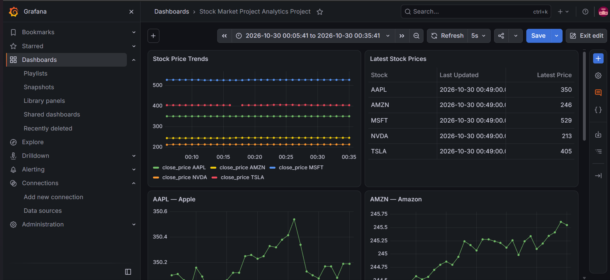

An end-to-end real-time market analytics pipeline built using **Kafka, Spark Structured Streaming, PostgreSQL, Airflow, and Grafana**, deployed on **AWS EC2**.

---

## 🏗️ System Architecture

```text
Finnhub WebSocket ──▶ Kafka ──▶ Spark Structured Streaming ──▶ PostgreSQL ──▶ Grafana
                                                                   ▲
Twelve Data Hourly API ──▶ Airflow (One-Time Backfill) ────────────┘
```

### Data Flow
1. **`finnhub_websocket_producer.py`** streams live Finnhub trades in real time.
2. **Kafka** stores normalized market events in the `market_ticks` topic.
3. **Spark Structured Streaming** reads the topic, handles late records using an event-time watermark, and builds **one-minute OHLCV candles**.
4. **Spark** upserts candles into **PostgreSQL** and refreshes `pair_analysis_24h`.
5. **Airflow** performs an initial backfill of the previous 24 hours of hourly candles to fill gaps in live coverage.
6. **Grafana** visualizes live candlesticks, trading volume, and per-symbol 24-hour market metrics.

---

## 🌐 Live AWS Demo
* **Grafana Dashboard:** [http://16.16.143.249:3000](http://16.16.143.249:3000) *(Hosted on AWS EC2)*

---

## 🧩 Core Components
* **Kafka & Zookeeper:** Real-time event ingestion and distributed buffering.
* **Spark Structured Streaming:** One-minute OHLCV, trade count, and VWAP aggregation.
* **PostgreSQL:** Operational storage for live candles, backfill history, and 24-hour reporting tables.
* **Airflow:** Automated one-time Twelve Data hourly-candle backfill (`finnhub_24h_hourly_backfill` DAG using TaskFlow API `@dag` and `@task.python`).
* **Grafana:** Real-time operational market monitoring dashboard.

### PostgreSQL Tables
* `candles_1m` – Live one-minute OHLCV candles.
* `candles_1h_backfill` – Hourly Twelve Data historical backfill candles.
* `pair_analysis_24h` – Latest rolling 24-hour market metrics per symbol.

---

## 📊 Grafana Dashboard Previews

### 1. Latest Stock Prices Overview
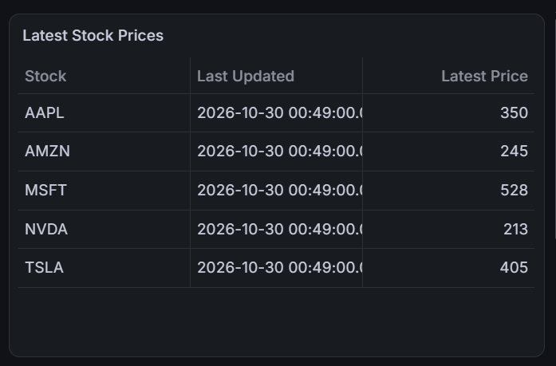

### 2. Multi-Stock Price Trends
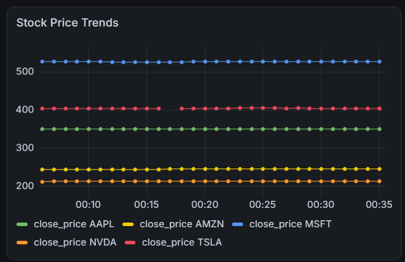

### 3. AAPL — Apple Inc. Live Price Trend
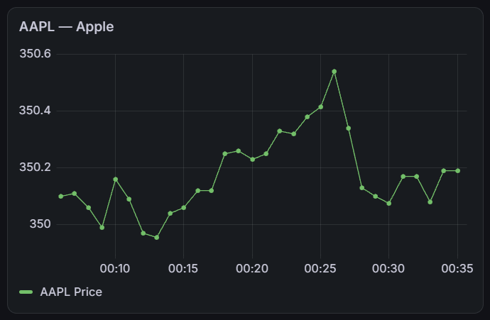

### 4. AMZN — Amazon.com Inc. Live Price Trend
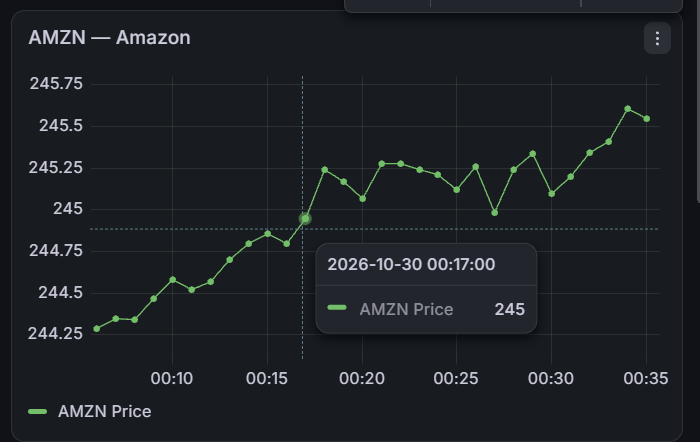

### 5. MSFT — Microsoft Corp. Live Price Trend
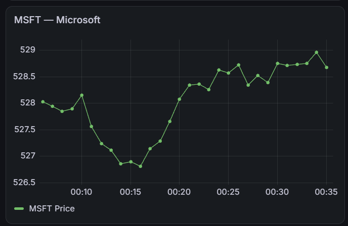

### 6. NVDA — NVIDIA Corp. Live Price Trend
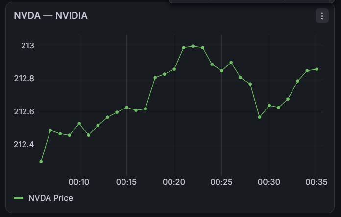

### 7. TSLA — Tesla Inc. Live Price Trend
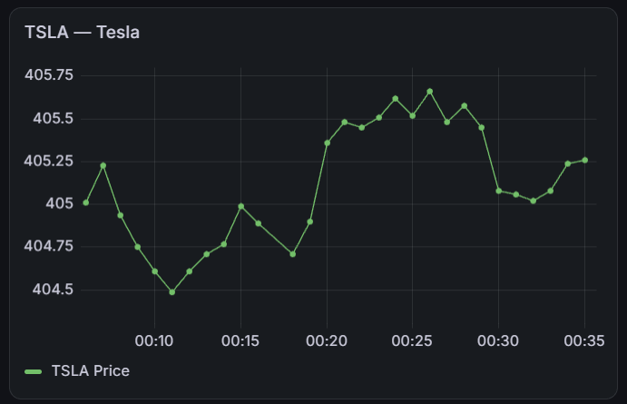

---

## ⚙️ Real-Time Pipeline Execution Logs

### 1. Finnhub WebSocket & Kafka Producer Stream
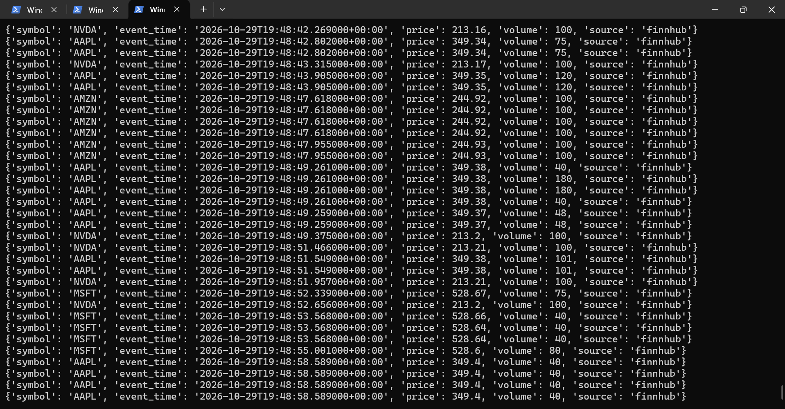

### 2. Kafka Consumer Normalized Market Events
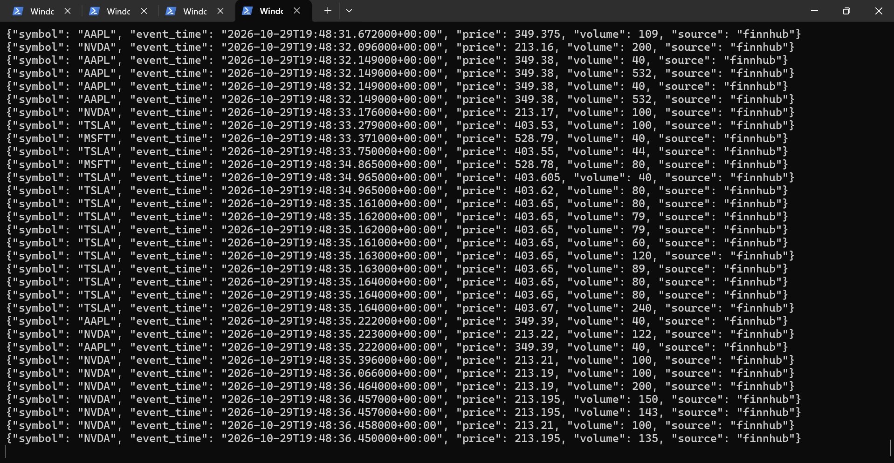

### 3. Spark Structured Streaming Execution Stages
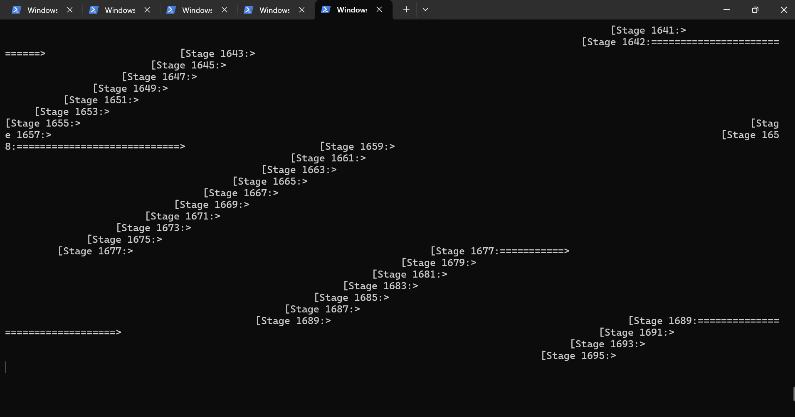

---

## 🚀 Prerequisites & Quick Start

### 1. Local Services
Ensure Kafka, PostgreSQL, Airflow, and Grafana are running locally on their default ports:
* **Kafka:** `localhost:9092`
* **PostgreSQL:** `localhost:5432`
* **Airflow:** `http://localhost:8080`
* **Grafana:** `http://localhost:3000`

### 2. Create Kafka Topic & Database Schema
Create the five-partition `market_ticks` topic and apply `sql/postgres/schema.sql` to PostgreSQL before starting the pipeline:

```bash
kafka-topics.sh --bootstrap-server localhost:9092 --create --if-not-exists \
  --topic market_ticks --partitions 5 --replication-factor 1
```

### 3. Environment Configuration
Create your `.env` file from the example template and add your private credentials:

```bash
cp .env.example .env
```

```env
FINNHUB_API_KEY=your_finnhub_key_here
TWELVE_DATA_API_KEY=your_twelve_data_key_here
POSTGRES_PASSWORD=your_postgres_password
```

### 4. Start the Live Producer
```bash
python3 src/producer/finnhub_websocket_producer.py
```
